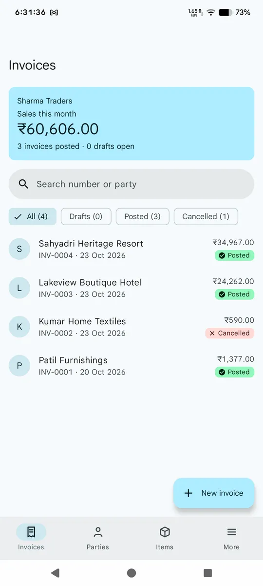
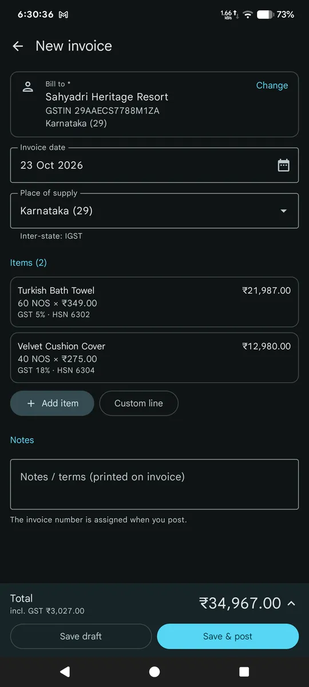
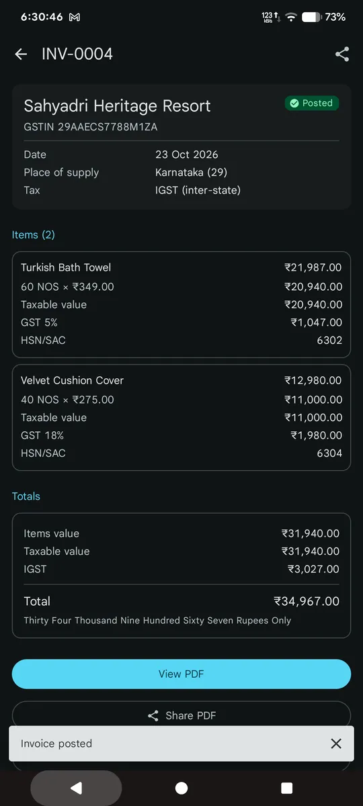
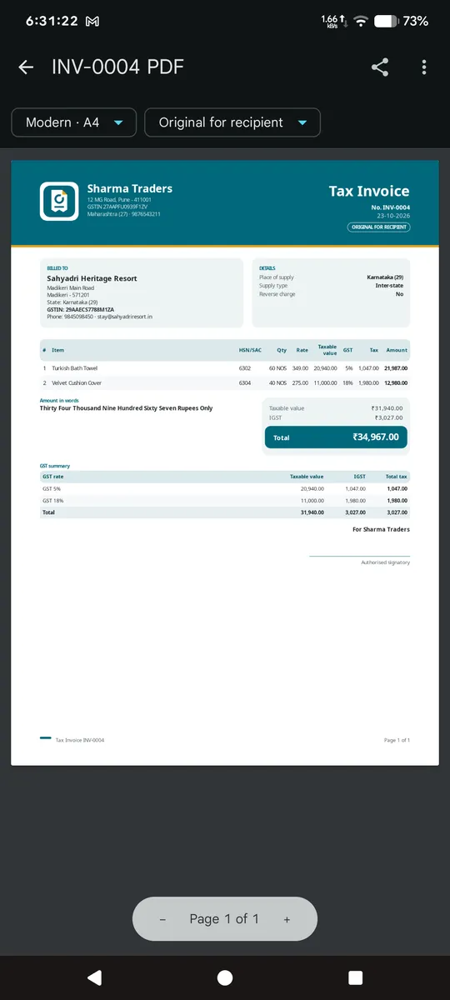
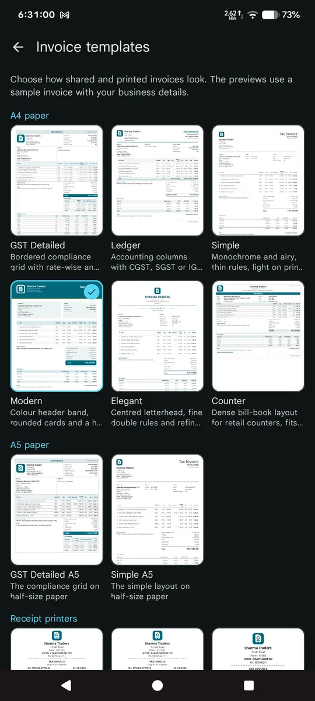
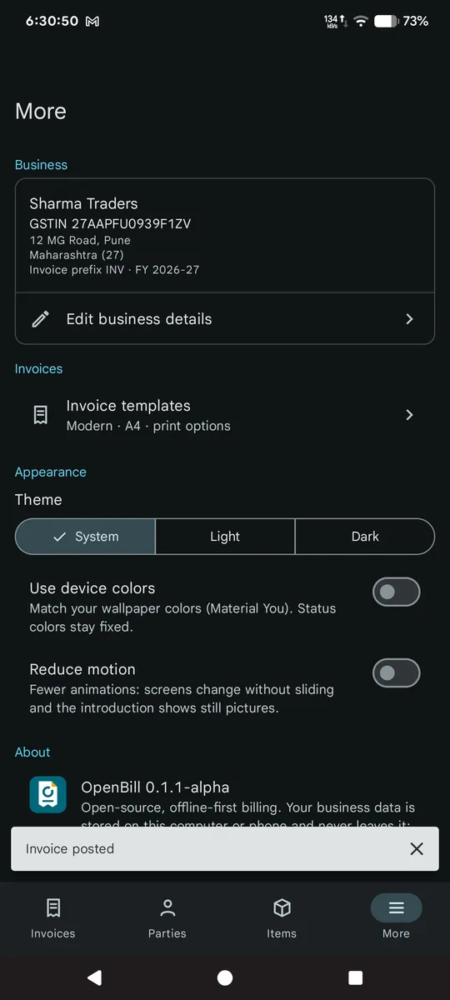
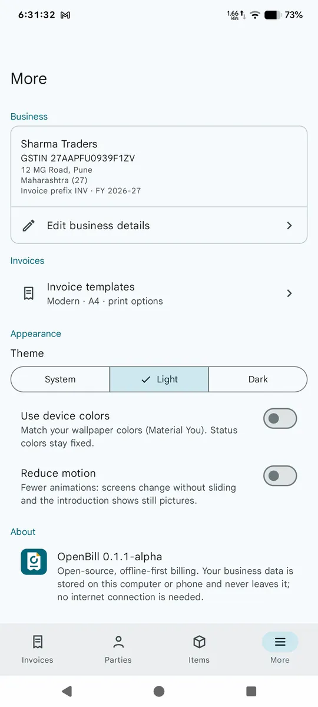
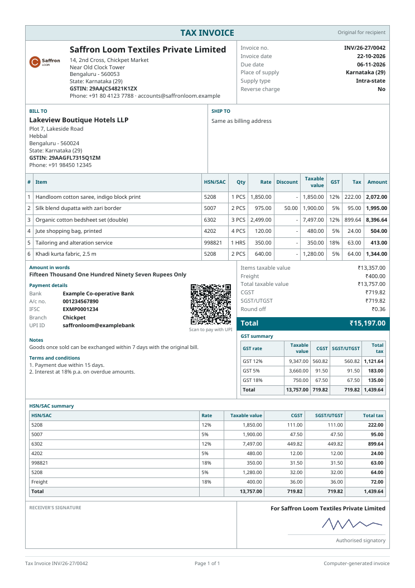

# OpenBill

Open-source, offline-first GST billing and invoicing for Indian MSMEs. Android, Windows,
and Linux from one Kotlin codebase.

[](https://github.com/zenithblue-oss/openbill/releases/latest)
[](LICENSE)


> **Alpha.** Invoicing, inventory, payments, reports, GST exports, backup, CSV import and the
> CLI work today; the remaining 1.0 gaps are listed in [What's left](#whats-left).

## Download

Latest: [v0.1.1-alpha](https://github.com/zenithblue-oss/openbill/releases/latest) (all
files are listed with `SHA256SUMS`).

| Platform | File | Notes |
| --- | --- | --- |
| Android 8.0+ | signed `.apk` | Allow installs from this source, then open the APK |
| Windows | `.exe` installer, `.msi`, portable `.zip` | Unzip the portable build and run `OpenBill.exe` |
| Linux | `.deb`, portable `.tar.gz` | `sudo apt install ./openbill_*.deb`, or extract and run `./OpenBill/bin/OpenBill` |

Builds are unsigned for Windows/Linux and the app is alpha: back up anything you care about.

## Coming to F-Droid

An F-Droid listing is being prepared (metadata in `fastlane/` and `docs/fdroid/`).
Once accepted, a badge will appear here: `https://f-droid.org/packages/app.openbill.android/`.

## Screenshots

<table>
  <tr>
    <td></td>
    <td></td>
    <td></td>
    <td></td>
  </tr>
  <tr>
    <td align="center">Invoice list</td><td align="center">Editor and totals</td><td align="center">Invoice detail</td><td align="center">PDF viewer</td>
  </tr>
  <tr>
    <td></td>
    <td></td>
    <td></td>
    <td></td>
  </tr>
  <tr>
    <td align="center">Template gallery</td><td align="center">Appearance (dark)</td><td align="center">Appearance (light)</td><td align="center">GST Detailed PDF</td>
  </tr>
</table>

More rendered PDFs: [Simple](docs/screenshots/pdf/simple.png), [Modern](docs/screenshots/pdf/modern.png).

<!-- TODO: desktop screenshots (Windows/Linux) pending; add to docs/screenshots/desktop/ and a table row here. -->

## Features available now

- GST sales invoices with CGST/SGST (intra-state) or IGST (inter-state) picked from place of supply.
- Line discounts (amount or %), GST-inclusive or exclusive rates, automatic round-off.
- Drafts, post (assigns a number), and cancel with an audit trail.
- Parties (customers and suppliers, GSTIN validation, state from GSTIN) and items (goods and services, HSN/SAC, GST rate).
- 12 PDF templates in A4, A5, and 58/80 mm thermal sizes; business logo and signature; UPI QR; copy labels (original/duplicate/triplicate).
- PDF viewer with share, print, and save.
- Material 3 with dynamic color and dark mode; keyboard shortcuts on desktop.
- Offline by design: no account, no ads, no trackers.
- Tax engine supports additional charges (entry screen pending).

Onboarding is coming in the next release.

## Progress

Method: every row in [docs/01-feature-inventory.md](docs/01-feature-inventory.md) was checked
against what is usable in the app today. A feature counts 1 when it works end to end, 0.5 when
only the engine/data layer exists without UI, and 0 otherwise. These are the maintainers' estimates, not a test metric.

**1.0 scope: about 94% (about 128 of 136 P0 features)** `███████████████████░`
**Full parity: about 47% (about 131 of 277 P0+P1+P2 features)** `█████████░░░░░░░░░░░`

| Area | Status | Done |
| --- | --- | --- |
| Billing and vouchers | Invoices, quotations, proforma, challans, credit/debit notes, purchases, duplicate, recycle bin, restore cancelled, attachments | 100% (22 / 22) |
| Parties and items | Masters, ledgers, statements, CSV import (one transaction), offline HSN/SAC search, business switcher | 94% (29 / 31 P0) |
| Inventory | Godowns, batches (FEFO picker), serials, adjustments, transfers, valuation, labels | 95% (est.) |
| Payments and accounting | Payments, allocation, split tender, expenses, accounts, ageing, reconciliation, reminder templates | 100% (14 / 14) |
| Reports and GST | Registers, books, statements, stock, profit, GST/HSN, GSTR-1 JSON, Tally XML | 95% (18 / 19) |
| Printing and output | Templates, party balance, A4/A5/thermal PDF, print, bulk export/print, share with summary, share as image; silent print pending | 90% (13.5 / 15) |
| Data and backup | Backup/restore with attachments, daily automatic backups, portable desktop mode, business deletion, CSV, Tally, GSTR-1; secure storage pending | 95% (9.5 / 10) |
| Desktop apps | Windows and Linux builds run the shared UI | Alpha |
| CLI | Direct mode: masters, invoices and PDF, payments, stock, import/export, reports, GST, Tally, audit | C0-C3 |
| Server | Not started (post-1.0) | 0% |

## What's left

Phases are defined in [ROADMAP.md](ROADMAP.md); details in [docs/04-implementation-plan.md](docs/04-implementation-plan.md).

Remaining 1.0 (P0) gaps:

- Output: silent print to the default printer, export notification with show-in-folder,
  direct Bluetooth/USB thermal printing.
- Data: secure storage; physical erasure of a deleted business (it is hidden today, its rows
  stay in the database file); backup schedule and retention settings (fixed at daily, keep 7).
- Desktop: packaging and signing.
- Optional server after 1.0.

OpenBill is a clean-room project. It is not affiliated with, endorsed by, or derived from
the source code of myBillBook or any other commercial billing product. See
[NOTICE](NOTICE) and [docs/06-clean-room-policy.md](docs/06-clean-room-policy.md).

## Why this project exists

Indian small businesses are increasingly dependent on closed billing platforms. When a
vendor changes pricing, removes a feature, loses data, or stops supporting a device,
businesses have little recourse. OpenBill aims to provide a transparent, local-first
alternative:

- Your data stays in an open SQLite database that you can back up and move.
- Core billing and inventory work without a network connection.
- No advertising SDKs, contact harvesting, or hidden telemetry.
- Import and export are first-class features, not paid add-ons.
- The tax engine is testable and auditable.
- The same data model works on a phone, a Windows laptop, and a Linux desktop.

This is not a get-rich-quick clone. Correctness, data durability, and print quality matter
more than shipping every competitor feature in the first release.

## Planned platforms

| Platform | Form factor | Status | Packaging |
| --- | --- | --- | --- |
| Android | Phone and tablet | First target | APK, AAB |
| Windows | Desktop and laptop | Planned | MSI |
| Linux | Desktop and laptop | Planned | DEB, AppImage |
| iOS | Phone and tablet | Not planned for 1.0 | - |
| Web | Browser | Not planned; optional later | - |
| [Server](docs/10-server.md) | Self-hosted, optional | Planned, after 1.0 | OCI image, JAR |
| [CLI](docs/11-cli.md) | Terminal, scripting and reports | Planned; direct mode ships with 1.0 | Archives, DEB, MSI component |

Windows and Linux are first-class targets, not afterthoughts. The domain, database, tax,
search, reporting, and import/export layers are shared through Kotlin Multiplatform. The
UI is shared with Compose Multiplatform. Platform-specific code is limited to printing,
file pickers, share sheets, secure storage, notifications, and packaging.

The repository is `zenithblue-oss/openbill` (https://github.com/zenithblue-oss/openbill). The project name is **OpenBill**.

## MVP scope

### Business and master data

- Business profile with GSTIN, state, address, logo, signature, and bank details.
- Multiple firms per installation, with a clear active-firm switch.
- Parties: customers and suppliers, billing and shipping addresses, opening balances,
  GSTIN, and contact details.
- Items: goods and services, SKU, category, unit, HSN/SAC, tax rate, MRP, sale price,
  purchase price, and wholesale price.
- Units, categories, godowns, and payment modes.

### Billing

- GST and non-GST sales invoices.
- Quotations, proforma invoices, credit notes, debit notes, and purchase bills.
- Inclusive and exclusive tax, CGST/SGST/IGST, cess, discounts, additional charges,
  and round-off.
- Configurable invoice numbering and financial year handling.
- A4, A5, and thermal (58 mm / 80 mm) PDF output.
- Share PDF or image through the Android share sheet or the desktop save dialog.
- Duplicate, cancel, and restore invoices with an audit trail.

### Inventory

- Stock ledger derived from vouchers, not silently overwritten quantities.
- Multiple godowns and stock transfer.
- Batch and expiry tracking.
- Serial number / IMEI tracking.
- Stock adjustment with a reason.
- Low-stock alerts.
- Barcode generation and label printing.

### Money

- Payment-in and payment-out vouchers.
- Partial payments and allocation against invoices.
- Expense vouchers with categories.
- Party ledger, outstanding receivables, and payables.
- Cash and multiple bank accounts.
- UPI QR on invoices (static, generated locally).
- Manual bank reconciliation and CSV statement import.

### Reports and compliance

- Sales, purchase, day book, party statement, stock summary, item-wise profit, and
  expense reports.
- GST summary, HSN summary, and GSTR-1 CSV export.
- Financial-year close with opening balances.
- Tally-compatible XML export.
- Full backup and restore in an open, documented archive format.

### Command line

- `openbill` CLI in direct mode on a local database or a backup file: `db`, `backup`,
  masters, vouchers, search, stock, payments, CSV import/export, reports, GSTR-1, HSN, Tally
  export, and audit commands, with stable `--json` output and exit codes (milestones C0-C3).
- Remote mode and server administration follow the optional server, after 1.0.

See [docs/11-cli.md](docs/11-cli.md).

### Search

Search is a first-class workflow, not a filter bolted onto one screen.

- Command palette (Ctrl/Cmd+K) and list search (Ctrl/Cmd+F) on desktop, search icon on Android; search across invoices, parties,
  items, payments, and expenses.
- Invoice search by invoice number, party name, and amount.
- Item search by name, SKU, HSN, and barcode, with stock-state filters.
- Party search by name and phone number.
- Offline HSN/SAC lookup.
- Local full-text index with ranked results and highlighted matches.
- 300 ms debounce, cancellation of stale queries, and paging for large result sets.

The evidence behind these decisions is in
[docs/02-search-analysis.md](docs/02-search-analysis.md).

### Scope of record

MVP means required for 1.0. The authoritative phase-by-phase scope is in
[ROADMAP.md](ROADMAP.md); [docs/01](docs/01-feature-inventory.md) uses P0/P1/P2 priorities
that map to it. Features outside Phases 1-6 of the roadmap are after 1.0.

## Explicit non-goals for the MVP

- Reimplementing a proprietary backend or scraping a competitor service.
- Copying myBillBook assets, themes, illustrations, strings, or database schema.
- Payment processing or lending. OpenBill records payments; it does not move money.
- Automated GST portal filing. The MVP exports data in portal-compatible formats.
- e-invoice and e-way bill registration without the user's own credentials and a
  compliant integration.
- AI OCR, WhatsApp Business API messaging, and an online storefront. These are later
  integrations with bring-your-own provider credentials.
- A hosted multi-tenant SaaS in the MVP. The first release is local-first.

## Planned technology stack

| Concern | Choice |
| --- | --- |
| Language | Kotlin |
| UI | Compose Multiplatform (Android and desktop) |
| Architecture | Feature modules, MVVM with unidirectional state |
| Dependency injection | Koin (KMP-friendly); Hilt is Android-only |
| Local database | Room KMP with bundled SQLite, including FTS5 |
| Paging | Paging 3 on Android; shared paging abstraction for desktop |
| Async | Coroutines and Flow |
| Networking | Ktor client; optional sync backend is not part of MVP |
| Server (post-1.0) | Ktor server, SQLite default, PostgreSQL optional |
| CLI | Clikt on the JVM; native image after a spike |
| Serialization | kotlinx.serialization |
| Preferences | DataStore KMP |
| Background work | WorkManager on Android; coroutine scheduler on desktop |
| PDF | Platform renderer behind a shared interface |
| Printing | Android PrintManager; desktop Java printing / CUPS |
| Barcode | ZXing |
| Testing | JUnit, Kotlin test, Turbine, Room in-memory tests, Compose UI tests |
| Build | Gradle with version catalogs, KSP where required |
| CI | GitHub Actions matrix for Android, Linux desktop, Windows desktop |

Versions are pinned in `gradle/libs.versions.toml` (AGP 8.13.2, Kotlin 2.3.10,
Compose Multiplatform 1.11.1). Android 8.0 (API 26) is the minimum; the project compiles
and targets API 36 at the time of writing and will move to the latest stable target before
release.

## Repository layout (target)

Gradle project names are flat (`:androidApp`, `:desktopApp`, `:core-model`, ...; see
`settings.gradle.kts`). The tree below is the planned shape; modules marked (planned) do
not exist yet.

```text
openbill/
  androidApp/               Android application shell
  desktopApp/               Windows and Linux desktop shell
  core-model/               Domain entities and value objects
  core-tax/                 GST tax and rounding engine
  core-domain/              Use cases and repository ports
  core-database/            Room KMP database, DAOs, migrations, FTS
  core-data/                Repositories, backup, import/export
  core-ui/                  Design system and shared screens
  core-search/              Query parsing, ranking, highlights (planned)
  core-reporting/           Report models and exports (planned)
  core-printing/            Print layout contracts (planned)
  core-api-contract/        DTOs and OpenAPI source for API, CLI, sync (planned)
  core-sync/                Operation log, outbox, sync client (planned, post-1.0)
  platform/                 expect/actual boundaries (planned)
  platform-android/  platform-desktop/  platform-jvm/   (planned)
  cli/                      openbill command-line tool (planned)
  server/                   OpenBill Server (planned, post-1.0)
  feature-*/                onboarding, dashboard, parties, items, inventory,
                            billing, payments, expenses, reports, gst, settings, search, backup (planned)
  docs/
  gradle/
```

A single Gradle build owns all targets. Android and desktop applications share the same
feature screens unless a platform-specific interaction genuinely requires a different UI.

## Documentation

- [Roadmap](ROADMAP.md)
- [Reverse-engineering report](docs/00-reverse-engineering.md)
- [Feature inventory](docs/01-feature-inventory.md)
- [Search analysis](docs/02-search-analysis.md)
- [Architecture](docs/03-architecture.md)
- [Implementation plan](docs/04-implementation-plan.md)
- [Test plan](docs/05-test-plan.md)
- [Clean-room policy](docs/06-clean-room-policy.md)
- [Windows and Linux desktop strategy](docs/07-desktop.md)
- [Glossary](docs/08-glossary.md)
- [Tax assumptions](docs/09-tax-assumptions.md)
- [Sync server](docs/10-server.md)
- [CLI](docs/11-cli.md)
- [Design system](docs/12-design-system.md)
- [Brand identity](docs/13-brand.md)

## Contributing

Contributions are welcome now, including code and specifications. See
[CONTRIBUTING.md](CONTRIBUTING.md) for build and test commands, clean-room rules, and
other ways to help.

Read [docs/06-clean-room-policy.md](docs/06-clean-room-policy.md) before contributing.
Do not submit code, assets, strings, or database schemas copied from a proprietary
application. Do not submit APKs or decompiled output.

## License

Apache License 2.0. See [LICENSE](LICENSE).

"myBillBook" is a trademark of its respective owner and is used here only for nominative
comparison. OpenBill is an independent project.
